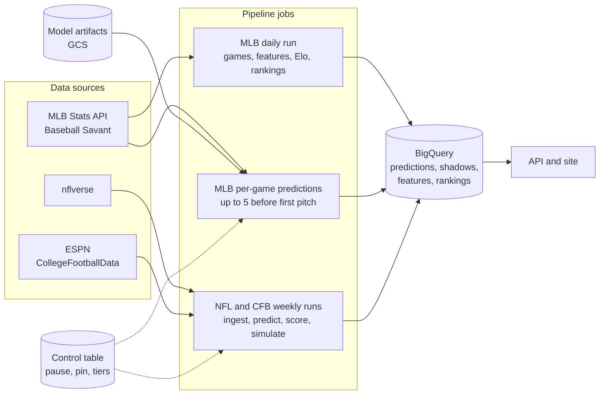

# Hank's Tank ML

The prediction pipeline behind [hankstank.com](https://hankstank.com). It ingests MLB, NFL and
college football data, builds features, predicts every game, scores the predictions once the games
finish, and publishes power rankings and rest-of-season projections. Everything it produces lands in
BigQuery. The [API](https://github.com/elijahcraig45/hanks_tank_backend) and the
[site](https://github.com/elijahcraig45/hanks_tank) only read it.



## What's running (2026-11-16)

| | Headline model (shown on the site) | Shadows (scored, not shown) | How it's doing |
|---|---|---|---|
| MLB | V10 XGBoost, 73 features (lineup matchups, Elo, recent form) | 3-feature logistic; plate-appearance simulator blended with team strength | 54.0% correct on 1,984 pregame predictions in 2026, against a 52.8% home-team win rate |
| NFL | Margin ridge (from 2026 week 9) | XGBoost (the previous headline), regularized XGBoost, drive simulator; ESPN FPI kept for comparison | Backtest 2017–24 log loss 0.634, vs 0.646 for XGBoost and 0.609 for the betting market (`make demo` reruns it) |
| College football | Margin ridge (from 2026 week 11) | XGBoost (the previous headline), ridge with a preseason program prior, drive simulator; ESPN FPI for comparison | Backtest 2025 FBS log loss 0.480, vs 0.531 for XGBoost |
| Power rankings | Bradley–Terry (MLB) and margin ratings (NFL, CFB) with bootstrap rank ranges, plus a results-based college resume board | | |
| Season projections | Monte Carlo of the rest of the season, 10,000 runs (NFL and FBS) | | NFL 2018–25 playoff-odds Brier score 0.149, vs 0.166 for extrapolating each team's record |

Baseball games are close to coin flips, so the whole MLB signal is small. The history has bigger
numbers that do **not** describe the live system: 61.48% (a V10 research build scored on 283 early
games with rebuilt features), 57.65% (V8, the best of about 20 variants on one holdout) and "158
features" (the canonical list; the deployed artifact uses 73).

## How a model earns the headline

1. **Walk-forward backtest** against the current headline on the same games, with paired-bootstrap
   confidence intervals. Settings are chosen on earlier seasons and scored on later ones.
2. **Leakage rules.** Only predictions made before first pitch or kickoff count, and feature rows
   computed after a game started are dropped.
3. **Live shadow.** The candidate writes its own table for weeks and is scored on games nobody had
   seen when it was built.
4. **Promotion is a reviewed pull request** with the evidence attached. A BigQuery control table can
   pause, hide or pin any model on the site without a deploy.

Most candidates don't make it. A plate-appearance simulator, an NFL drive simulator, an Optuna
search across seven model families and a CFB margin cap all stayed out of the headline.
[docs/EXPERIMENT_LOG.md](docs/EXPERIMENT_LOG.md) records every experiment with its numbers and
verdict, including the failures.

## Check the NFL result yourself

```bash
make demo   # about 5 seconds after a one-time install; no network, no cloud account
```

This reruns the backtest that moved the NFL headline from XGBoost to the margin ridge. It uses the production code
in `src/nfl` and one committed file of nflverse schedules. It tunes the ridge on 2010–2016, walks forward through
2017–2025, and prints accuracy, log loss and Brier score for Elo, XGBoost, the ridge and the betting market, with a
paired-bootstrap interval on the ridge-minus-XGBoost gap. The numbers match the experiment log, and a CI test fails
if they move. [demo/README.md](demo/README.md) has the expected output and what the demo leaves out.

## Where it runs

Since October 2026 the jobs run on a homelab server as systemd timers: 12 scheduled jobs plus a
per-game planner that queues each MLB prediction (a baseline, then 6 h, 3 h, 90 min and 45 min before
first pitch). They call the same entry points with the same request bodies as the Cloud Functions
they replaced, and each release is a pinned commit of this repo. The Cloud Functions, their paused
Cloud Scheduler jobs and the paused Cloud Tasks queues stay deployed as a manual fallback. The host
layer (installer, units, runner, health checks) lives in
[hanks_tank_lab](https://github.com/elijahcraig45/hanks_tank_lab).

## Docs

| Doc | What it covers |
|---|---|
| [docs/ML_SYSTEM.md](docs/ML_SYSTEM.md) | The main reference: entry-point modes, tables written, model fallback chains, safe run/test/deploy steps and monitoring queries |
| [docs/EXPERIMENT_LOG.md](docs/EXPERIMENT_LOG.md) | Every model generation and experiment, V1 to the 2026 football work, with measured results and verdicts |
| [docs/MODEL_CARDS.md](docs/MODEL_CARDS.md) | One card per live or shadow model |
| [docs/SHADOW_MODELS.md](docs/SHADOW_MODELS.md) | The MLB shadow writers (logit3, sim_blend) |
| [research/backtest_2026/FINDINGS.md](research/backtest_2026/FINDINGS.md) | The 2026 MLB backtest programme |
| [research/football_2026_09/README.md](research/football_2026_09/README.md) | The football experiments |
| [demo/README.md](demo/README.md) | The offline NFL backtest behind `make demo` |

## Code map

| Path | Role |
|---|---|
| `src/cloud_function_main.py` | MLB entry point; `daily_pipeline` dispatches on `mode` (`src/main.py` re-exports it) |
| `src/season_2026_pipeline.py` | MLB data collection (`--dry-run`, `--date`) |
| `src/predict_today_games.py` | MLB prediction and the V10 → V4 model fallback chain |
| `src/build_v8_features_live.py`, `src/build_v10_features_live.py` | Live MLB feature builders |
| `src/train_v10_models.py` | Builds the V10 artifact |
| `src/logit3_shadow.py`, `src/pa_sim/` | MLB shadow models |
| `src/nfl/main.py`, `src/cfb/main.py` | Football entry points |
| `src/nfl/margin_ridge.py` | The margin ridge model used as the football headline |
| `src/season_sim/` | Rest-of-season Monte Carlo |
| `src/rankings/` | Power rankings, rank ranges, rationale and the college resume board |
| `src/stats/` | Player stats, CFBD ingest, pick'em sheet |
| `scripts/gcp/` | Cloud Function deploys for the fallback (all support `--dry-run`) |
| `demo/` | The offline NFL backtest (`make demo`) and its nflverse snapshot |

## Safety rules (short form)

- **Deploys are manual.** CI runs the tests and has no GCP credentials. The homelab installs a pinned
  commit; the scripts in `scripts/gcp/` keep the Cloud Function fallback current.
- **A fallback deploy must not switch the cloud schedules back on** while the homelab runs the jobs,
  or both will write. Deploy the NFL and CFB functions with `--only-function --shadow --keep-env`.
  `deploy_v10.sh` (MLB) has no such flag: it deletes and recreates the MLB Scheduler jobs, and new
  jobs start enabled, so pause them again straight after. For code-only, add `--skip-model-upload`.
- **Never call the football functions to test them.** On MLB, `daily` still DELETEs duplicate `games`
  rows even with `dry_run`.
- **Score models only on pregame rows**, i.e. `predicted_at < game_time_utc` inside the dedupe.

## Local development and tests

```bash
python -m pip install -r requirements.txt pytest "polars==1.*"
python -m pytest tests -v          # 565 tests in CI
python -m compileall src scripts demo
python3 src/season_2026_pipeline.py --dry-run --date 2026-09-24
```

`requirements.txt` is pinned and mirrored byte-for-byte to `src/requirements.txt`. Change both
together.

## License

MIT
